<div align="center">



<a href="https://github.com/Anandtripathiii">
  
</a>

<br/>


[](https://anand-ouiii.vercel.app/)
[](https://www.linkedin.com/in/anand-tripathi-31371232b/)
[](https://x.com/Ouiii_Anand)
[](https://www.instagram.com/ouiii_.anand)


</div>

---

## About

> Computer Science engineering student focused on **shipping production-grade software** where **applied AI** meets **full-stack engineering**.

I design and deploy **end-to-end AI systems**: **Retrieval-Augmented Generation (RAG)** pipelines, multi-LLM orchestration, and live web applications. My work covers **FastAPI / Flask** backends, **vector search** with FAISS and ChromaDB, guardrails against hallucination, and deployment with **per-session isolation, rate limiting, and secure auth**.

I care about clean architecture, reproducible pipelines, and software that holds up with real users.

| | |
|:--|:--|
| **Core focus** | Software Engineering, Applied AI/ML, RAG Systems, Full-Stack Development |
| **Engineering DNA** | Production reliability, prompt engineering, vector search, secure deployment |
| **Open to** | SDE internships, AI/ML engineering roles, open-source collaboration, freelance builds |

---

## Tech Stack

**Languages**


**Frontend**


**Backend and Databases**


**AI / ML / RAG**


**Cloud, DevOps and Tooling**


---

## AI / ML Expertise

| Domain | Level | Details |
|:--|:--:|:--|
| **RAG Pipelines** | `Advanced` | Custom retrieval with FAISS and ChromaDB, chunking, semantic search, source-grounded answers |
| **LLM Integration** | `Advanced` | Multi-model orchestration across Gemini and OpenAI with bring-your-own-key auth |
| **Prompt Engineering** | `Advanced` | Role prompting, few-shot, prompt chaining, self-evaluated confidence scoring |
| **Hallucination Control** | `Proficient` | Quote verification that validates every answer against source material |
| **Vector Search** | `Proficient` | Semantic embeddings with sentence-transformers over FAISS / ChromaDB |
| **Applied ML** | `Proficient` | Deep-learning object detection for real-time navigation and obstacle avoidance |
| **AI Product Safety** | `Proficient` | Prompt-safety guardrails, rate limiting, per-session isolation in production |

---

## Featured Projects

### [DocMind AI](https://github.com/Anandtripathiii/Docmind-AI): source-grounded document Q&A

Chat with your files while a **quote-verification layer** checks each generated answer against the source before it reaches you.

| | |
|:--|:--|
| **Stack** | Python, FastAPI, JavaScript, Google Gemini API, Netlify |
| **Scale** | Multi-file search with per-session document isolation |
| **Security** | Per-session isolation, request rate limiting |
| **Impact** | Answers verified line by line against source content |

### [CodePilot AI](https://github.com/Anandtripathiii/CodePilot-AI): dual-LLM coding assistant with RAG

Answers questions, debugs, and explains code by running **two LLMs** side by side, grounded in your uploaded files and live documentation.

| | |
|:--|:--|
| **Stack** | Python, Flask, FAISS, Gemini + OpenAI APIs, Gunicorn, Render |
| **Scale** | RAG over uploaded files plus live documentation search |
| **Security** | Per-visitor session isolation, bring-your-own-key auth, prompt-safety guardrails |
| **Impact** | Context-aware debugging and explanation across two complementary models |

### [NovaChart SupportAI](https://github.com/Anandtripathiii/NovaChart-SupportAI): prompt-engineered customer support

Classifies incoming issues, resolves them, and escalates to humans when needed, built as a **measurable prompt pipeline**.

| | |
|:--|:--|
| **Stack** | Python, Streamlit, Google Gemini API, Pandas |
| **Scale** | 8 support scenarios with automated issue classification |
| **Pipeline** | 5-stage prompt flow with self-evaluated confidence scoring |
| **Impact** | Benchmarks basic vs. few-shot vs. chained prompting on quality, accuracy and escalation |

**More:** [Ambedkar-Wikiii](https://github.com/Anandtripathiii/Ambedkar-Wikiii) (JavaScript) and [Web-Dev-Learning-Projects](https://github.com/Anandtripathiii/Web-Dev-Learning-Projects) (web development practice from Udemy).

---

## Experience

### Software Engineering Intern, Nexera
`April 2026 to June 2026` | `Remote`

Maintained and debugged a full-stack e-learning platform with video courses, downloadable study material and a DSA course, working across frontend and backend with the engineering team.

- Diagnosed and fixed frontend and backend issues to keep the platform stable for student users.
- Worked end to end across the stack on a live product with real users.
- Collaborated with frontend and backend developers to test features, resolve bugs and support platform updates.

---

## Achievements

| Recognition | Details |
|:--|:--|
| **Finalist, Pitch Tank (Groove'25, DTU)** | Pitched a startup transforming home gardening through curated products and professional gardening services |
| **Build with India Hackathon** | Built AI-based software solutions as part of Team Cipher Code |
| **KRMU 54-Hour Offline Hackathon** | Built an obstacle-detection system for autonomous delivery drones using deep-learning object detection and navigation |
| **AI Prompt Engineering, Summer Internship Training** | Completed structured training in applied prompt engineering |

---

## GitHub Analytics

<div align="center">


</div>

---

## Contribution Activity


---

## Current Focus

```yaml
learning:
  - Advanced RAG architectures and agentic AI workflows
  - Scalable system design and backend performance
  - LLM evaluation, guardrails and safety engineering
building:
  - Production AI apps with verifiable, source-grounded outputs
  - Multi-LLM orchestration with secure auth
  - Full-stack products on a strong engineering foundation
exploring:
  - Vector databases and semantic search at scale
  - Containerized deployment with Docker
  - Open-source AI tooling
```

---

<div align="center">

*"Engineering isn't just writing code. It's building systems people can trust."*


</div>
