<div align="center">

<a href="https://anand-ouiii.vercel.app/"></a>

<br/>

<a href="https://anand-ouiii.vercel.app/"></a>&nbsp;
<a href="https://www.linkedin.com/in/anand-tripathi-31371232b/"></a>&nbsp;
<a href="mailto:anandtripathiiiofficial@gmail.com"></a>&nbsp;
<a href="https://github.com/Anandtripathiii"></a>

<br/><br/>


</div>

<br/>

<!-- ===== 01 · ABOUT ===== -->

<div align="center">

</div>

<br/>

<div align="center">

</div>

<br/>

<div align="center">

</div>

<br/>

<!-- ===== 02 · PIXEL PANEL ===== -->

<div align="center">

</div>

<br/>

<div align="center">

</div>

<br/>

<!-- ===== 03 · PROJECTS ===== -->

<div align="center">

</div>

<br/>

<div align="center">

<a href="https://github.com/Anandtripathiii/Docmind-AI"></a>
<a href="https://github.com/Anandtripathiii/CodePilot-AI"></a>
<a href="https://github.com/Anandtripathiii/NovaChart-SupportAI"></a>
<a href="https://github.com/Anandtripathiii/Export-Automation"></a>
<a href="https://fleetflow-8x7h.onrender.com"></a>
<a href="https://github.com/Anandtripathiii/chargeevsetu"></a>
<a href="https://safher-ai.vercel.app"></a>

</div>

<br/>

<!-- ===== 04 · TECH ARSENAL ===== -->

<div align="center">

</div>

<br/>

<div align="center">

**Languages & Core**


**Backend & Databases**


<br/>


**Frontend**


**AI / ML / LLM**


**Automation & DevOps**


<br/>


</div>

<br/>

<!-- ===== 05 · STATS DECK ===== -->

<div align="center">

</div>

<br/>

<div align="center">

### CONTRIBUTION GRAPH


<br/>

### CONTRIBUTION SNAKE


<br/>

### STATS · STREAK · LANGUAGES


<br/>


<br/>

### TROPHIES


</div>

<br/>

---

<div align="center">

### <picture><source media="(prefers-color-scheme: dark)" srcset="https://img.shields.io/badge/-E13838?style=flat-square"></picture>&nbsp; EXPERIENCE

</div>

**Software Engineering Intern** &nbsp;·&nbsp; **Nexera** &nbsp;·&nbsp; Remote &nbsp;·&nbsp; `Apr 2026 – Jun 2026`

Maintained and debugged a full-stack e-learning platform used by students for video courses, downloadable study material, and a dedicated DSA course. Worked across both frontend and backend alongside the engineering team.

- Diagnosed and resolved frontend + backend issues to keep the platform stable for real student users
- Shipped fixes on a live product — tested features, closed bugs, supported ongoing updates
- Collaborated with other developers to review changes and plan next tickets

<p align="left">


</p>

---

<div align="center">

### <picture><source media="(prefers-color-scheme: dark)" srcset="https://img.shields.io/badge/-E13838?style=flat-square"></picture>&nbsp; ACHIEVEMENTS

| | Recognition | What |
| :---: | :--- | :--- |
| 🏆 | **Finalist · Pitch Tank — Groove'25, DTU** | Pitched a startup transforming home gardening through curated products and professional gardening services. |
| 🤖 | **Build with India Hackathon** | Built AI-based software solutions as part of Team *Cipher Code*. |
| 🚁 | **KRMU 54-Hour Offline Hackathon** | Built an obstacle-detection system for autonomous delivery drones using deep-learning real-time object detection & navigation. |
| 🧠 | **AI Prompt Engineering — Summer Internship Training** | Completed structured training in applied prompt engineering. |

</div>

---

<div align="center">

### <picture><source media="(prefers-color-scheme: dark)" srcset="https://img.shields.io/badge/-E13838?style=flat-square"></picture>&nbsp; AI / ML DEPTH

| Domain | Level | Details |
| :--- | :---: | :--- |
| **RAG Pipelines** | `Advanced` | Custom pipelines with FAISS & ChromaDB — chunking, semantic search, source-grounded answers (built by hand, not framework). |
| **LLM Integration** | `Advanced` | Multi-model orchestration across Gemini & OpenAI with BYO-key auth. |
| **Prompt Engineering** | `Advanced` | Role prompting, few-shot, prompt chaining, self-evaluated confidence scoring. |
| **Hallucination Control** | `Proficient` | Quote-verification systems that validate every answer against source material. |
| **Vector Search** | `Proficient` | Semantic embeddings with sentence-transformers over FAISS / ChromaDB stores. |
| **Applied ML** | `Proficient` | Deep-learning object detection for real-time navigation & obstacle avoidance. |
| **AI Product Safety** | `Proficient` | Prompt-safety guardrails, rate limiting, per-session isolation in production. |

</div>

---

<div align="center">

### <picture><source media="(prefers-color-scheme: dark)" srcset="https://img.shields.io/badge/-E13838?style=flat-square"></picture>&nbsp; CODING PROFILES

<a href="https://leetcode.com/u/anandtripathiii/">
  
</a>
&nbsp;
<a href="https://www.geeksforgeeks.org/user/anandtripathiii/">
  
</a>
&nbsp;
<a href="https://www.hackerrank.com/anandtripathiii">
  
</a>
&nbsp;
<a href="https://www.codechef.com/users/anandtripathiii">
  
</a>

</div>

---

<div align="center">

### <picture><source media="(prefers-color-scheme: dark)" srcset="https://img.shields.io/badge/-E13838?style=flat-square"></picture>&nbsp; CURRENT FOCUS

</div>

```yaml
building:
  - DocMind · CodePilot · NovaChart · Export-Automation
  - FleetFlow (IGNITE Round 2)  ·  ChargeEVSetu (Techfest IITB)
  - SafeHer AI (hackathon demo)

learning:
  - Advanced RAG architectures & agentic AI workflows
  - Scalable system design & backend performance
  - LLM evaluation, guardrails and safety engineering

exploring:
  - Vector databases & semantic search at scale
  - Containerized deployment with Docker
  - Open-source AI tooling

open_to:
  - SDE / AI-ML Engineering Internships
  - Open-Source Collaboration
  - Product Engineering Opportunities
```

---

<div align="center">

<a href="mailto:anandtripathiiiofficial@gmail.com"></a>&nbsp;
<a href="https://www.linkedin.com/in/anand-tripathi-31371232b/"></a>&nbsp;
<a href="https://github.com/Anandtripathiii"></a>&nbsp;
<a href="https://anand-ouiii.vercel.app/"></a>

<br/><br/>


</div>
