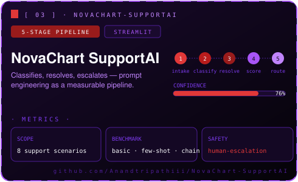
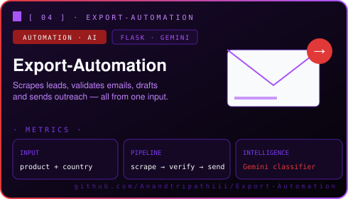
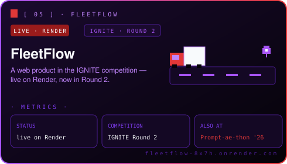
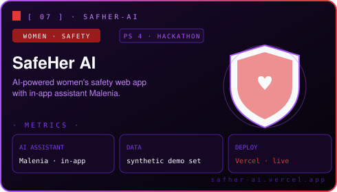

 

&nbsp;
&nbsp;
&nbsp;

  

  

  

  

 

  

  

 

### Languages

### AI & GenAI

### Backend

 

### Automation & Data

 

 

### Tools & Infrastructure

 

  

 

  

 

<picture>
  <source media="(prefers-color-scheme: dark)" srcset="https://raw.githubusercontent.com/Anandtripathiii/Anandtripathiii/output/github-contribution-grid-snake-dark.svg"/>
  <source media="(prefers-color-scheme: light)" srcset="https://raw.githubusercontent.com/Anandtripathiii/Anandtripathiii/output/github-contribution-grid-snake.svg"/>
  
</picture>

---

### &nbsp; EXPERIENCE

**Software Engineering Intern** &nbsp;·&nbsp; **Nexera** &nbsp;·&nbsp; Remote &nbsp;·&nbsp; `Apr 2026 – Jun 2026`

Maintained and debugged a full-stack e-learning platform used by students for video courses, downloadable study material, and a dedicated DSA course. Worked across both frontend and backend alongside the engineering team.

- Diagnosed and resolved frontend + backend issues to keep the platform stable for real student users
- Shipped fixes on a live product — tested features, closed bugs, supported ongoing updates
- Collaborated with other developers to review changes and plan next tickets

---

### &nbsp; ACHIEVEMENTS

| | Recognition | What |
| :---: | :--- | :--- |
| 🏆 | **Finalist · Pitch Tank — Groove'25, DTU** | Pitched a startup transforming home gardening through curated products and professional gardening services. |
| 🤖 | **Build with India Hackathon** | Built AI-based software solutions as part of Team *Cipher Code*. |
| 🚁 | **KRMU 54-Hour Offline Hackathon** | Built an obstacle-detection system for autonomous delivery drones using deep-learning real-time object detection and navigation. |
| 🧠 | **AI Prompt Engineering — Summer Internship Training** | Completed structured training in applied prompt engineering. |

---

### &nbsp; CODING PROFILES

&nbsp;
&nbsp;
&nbsp;

---

&nbsp;
&nbsp;
&nbsp;

  

